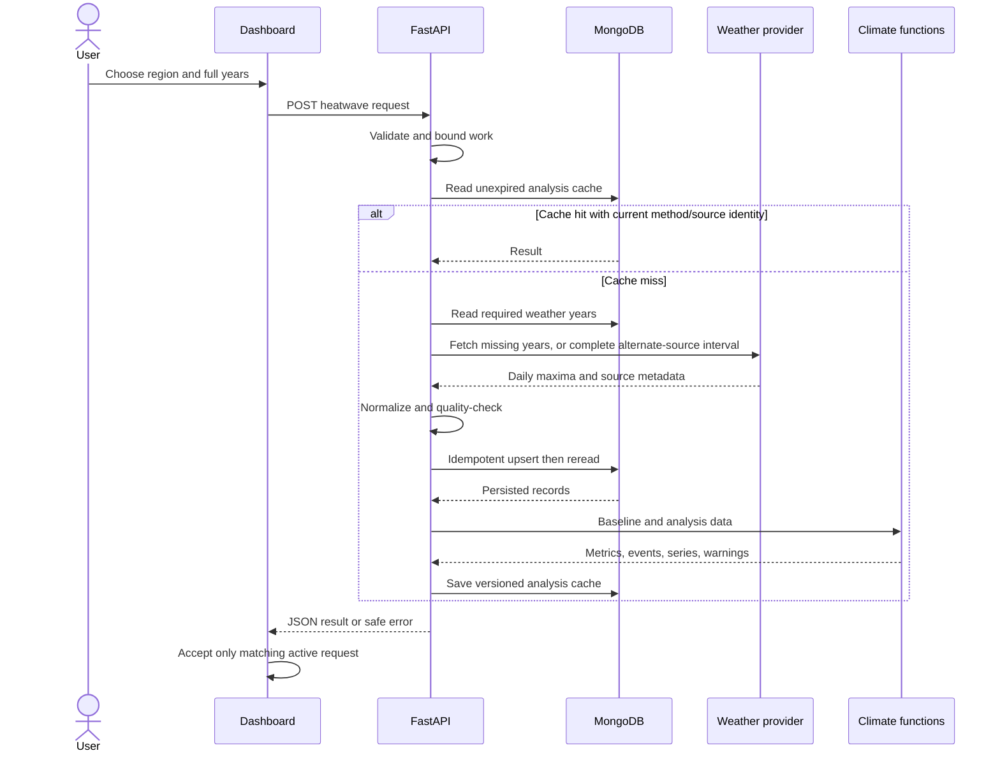

# System architecture

Status: intended application architecture with a draft settings/Atlas/health subset. No weather adapter, repository, climate engine or dashboard is implemented. Read [PRD](PRD.md), [contract](INTEGRATION_CONTRACT.md), [frontend design](frontend/docs/system.frontend.md), [backend design](backend/docs/system.backend.md), [coverage](docs/system-design-coverage.md) and [decision log](docs/decisions/README.md).

## Modules and ownership

| Module | Responsibility | Dependencies |
|---|---|---|
| dashboard | Form, request state, accessible charts and explanations | HTTP contract |
| api | Validation, rate limiting, response/error envelope | analysis service, schemas |
| analysis-service | Cache lookup, ingestion orchestration, persistence/readback, analysis | repository, provider, climate functions |
| provider | Fixed-host NASA/ERA5 fetching, eligibility, whole-source fallback, normalization; separate geocoding | Shared HTTP client |
| climate | Pure deterministic percentile, events, annual metrics and slope | Normalized input; no HTTP/database |
| repository | MongoDB queries, upserts, indexes, cache expiry | MongoDB driver |

Dependency direction runs from routes to service to adapters/domain. Domain functions never import routes or infrastructure. Keep a modular monolith: separate Python modules, one process/deployment. Add abstractions only at an actual boundary.

## Persistence and caching

Use `daily_weather` and `analysis_cache` initially, with source/date compound uniqueness and expiry-aware cache lookups. [Database](backend/docs/database.md) owns the document model; [pipeline and cache](backend/docs/data-pipeline.md) own completeness, expiry and concurrency behavior. Never treat a partially written weather batch as complete. Re-read persisted records before calculating, including on first ingestion.

## Security and failure flow

The browser is untrusted. Pydantic validates shape and limits; services enforce resource budgets. Provider responses are also untrusted and must be normalized. Application callers cannot supply URLs, query objects or model names. Browser CORS is not authentication or a rate limiter. See [security/configuration](backend/docs/security.md).

Provider timeout/retry exhaustion returns a typed safe error. MongoDB unavailability returns 503 instead of silently substituting an in-memory production database. Invalid or incomplete baseline returns an insufficient-data error. The UI preserves editable inputs and offers an explicit retry; no automatic retry storm.

## Operational design

Use a shared outbound client and pooled MongoDB client through application lifespan. Per-request state is local; persistent data is in MongoDB. One deployment worker initially makes process-local rate limits and duplicate-request locks effective within their stated scope. A second worker requires shared enforcement or an edge quota solution first. Bound in-memory lock/limiter entries and expire idle keys.

Structured logs contain request ID, endpoint, elapsed time, cache hit, provider status and counts. Do not log connection strings, keys, raw request bodies or full provider URLs. Measure hot/cold latency and cache hit ratio before optimizing.

## Trade-offs and scaling trigger

React local state avoids a global store for one page. Recharts is the provisional chart choice for responsive React composition; verify dependency/API/accessibility support before installation. A nine-point box sampler is bounded and explainable but cannot replace area-weighted gridded science. MongoDB is required persistence, while Redis, queues and distributed locks are deferred until measured workload requires them. No OpenDesign or OmniRoute dependency is in the application.

If supported cold requests repeatedly exceed the deadline after caching/chunking, document measurements and redesign the contract for durable jobs before introducing a queue. Do not pretend synchronous endpoints already support asynchronous job IDs.

## Authority and compatibility gates

Root PRD owns requirements, root contract owns wire semantics, backend methodology owns science, database owns proposed persistence shapes, pipeline owns provider/cache orchestration, frontend/docs/design.md owns visual tokens (root DESIGN links to it), and local system documents own component/module responsibilities. [The AI development workflow](docs/ai-development-workflow.md) owns roles, research/review and completion gates; it adds no runtime layer. [Coverage](docs/system-design-coverage.md) traces every concept to these authorities and tasks; do not create a competing API/schema or model document.

NASA POWER is the newly requested preferred eligible source, with Open-Meteo a conditional free non-commercial fallback. Both raw endpoints passed basic 1990–2020 probes. A result must use one consistent source for baseline and analysis, with explicit provenance and a source-specific cache identity. Contract 0.2 (DOC-004) carries the truthful source metadata. The climate definition itself is unchanged.

Connectivity is separate from persistence: existing app/database.py drafts client lifecycle and ping only; no collections/indexes are created. Atlas ping failed and BE-009 remains IN_PROGRESS. BE-005/BE-007 own future writes/cache orchestration. The latest scope is documentation alignment, so no analysis business features are added now.
