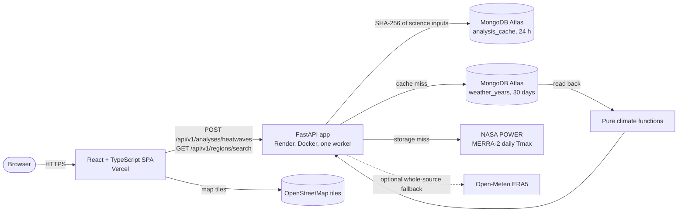

# Climate Hazard Trend Analyzer

A full-stack web application that detects historical heatwaves for a place or a small area and shows how their frequency, duration and intensity changed over up to 50 years, using daily maximum temperatures from climate reanalysis data.

- **Live app**: [climatetrend.vercel.app](https://climatetrend.vercel.app) (frontend on Vercel)
- **Live API health**: [climate-hazard-trend-analyzer-9gp4.onrender.com/api/v1/health](https://climate-hazard-trend-analyzer-9gp4.onrender.com/api/v1/health) (backend on Render's free plan; the first request after it has been idle takes 20–35 s while it wakes, and the app says so)
- **Design documents**: [architecture](ARCHITECTURE.md), [scientific methodology](backend/docs/climate-methodology.md), [API contract](INTEGRATION_CONTRACT.md), [decision records](docs/decisions/README.md), [verification log](docs/verification.md)

---

## 1. What it does

Pick a location (search, a city button, typed coordinates or a click on the map) or draw a box up to 2° × 2°, choose a period, and the app:

1. fetches decades of daily maximum temperatures for that place from NASA POWER, stores them in MongoDB, and reads them back;
2. sets a local heatwave threshold, the 95th percentile of 1991–2020 daily maxima at that place;
3. finds every heatwave (three or more consecutive days strictly above the threshold);
4. returns annual frequency, duration and temperature anomaly, a descriptive trend, every event, data-quality details and plain-language insights.

The browser shows this as summary metrics, a **heatwave calendar** (every event by year and day of year), three **linked line charts** (hovering or selecting a year highlights it everywhere and opens that year's details), a **result map** of what was analysed, the method and provenance, and a CSV export of the events.

Everything shown comes from the backend's response. The frontend never computes climate statistics, and the app never draws a heat "intensity map": reanalysis data at one point or nine sample points cannot support one.

---

## 2. Architecture



| Layer | Responsibility | Main files |
|---|---|---|
| Frontend | Inputs and validation guidance, request lifecycle, presentation of backend results | [`frontend/src/`](frontend/src/) |
| API | Strict request/response schemas, error envelopes, rate and capacity limits, CORS | [`backend/app/main.py`](backend/app/main.py), [`schemas.py`](backend/app/schemas.py), [`security.py`](backend/app/security.py) |
| Analysis service | Cache lookup, single-flight per request, source selection, readback, result assembly | [`backend/app/services/analysis.py`](backend/app/services/analysis.py), [`selector.py`](backend/app/selector.py) |
| Providers | Bounded HTTP clients that normalize NASA POWER and Open-Meteo data to UTC days in °C | [`backend/app/providers/`](backend/app/providers/), [`ingestion.py`](backend/app/ingestion.py) |
| Persistence | Weather stored one document per series-year; results cached by input hash; TTL expiry | [`backend/app/repositories/`](backend/app/repositories/) |
| Climate engine | Threshold, events, annual metrics, trend, insights; no I/O | [`backend/app/climate.py`](backend/app/climate.py), [`spatial.py`](backend/app/spatial.py) |

---

## 3. Architectural decisions and trade-offs

Each decision below says what was chosen, why, what it costs, and what was rejected. The full records with dates are in [docs/decisions](docs/decisions/README.md).

### 3.1 A modular monolith with pure climate functions

**Choice.** One FastAPI service. The science (`climate.py`, `spatial.py`) is pure functions with no I/O; HTTP clients, MongoDB and caching sit around them.

**Why.** The workload is one request type. Pure functions can be tested exhaustively with deterministic data, and one deployable is easier to run on free hosting.

**Cost.** API, ingestion and analysis scale together; a slow provider ties up the same worker that serves cached results.

**Rejected.** Separate ingestion and analysis services, or a job queue, would add infrastructure without a measured need (ADR-003, ADR-018).

### 3.2 The backend owns all science; the frontend only presents

**Choice.** Every number on screen (thresholds, events, annual values, trends, insights) comes from the API. The browser only formats, groups for display and links views.

**Why.** One authority means one place to test and correct the method, and no risk of the chart and the summary disagreeing.

**Cost.** New views need the API to return their data. The heatwave calendar was possible only because events were already returned. Its shading groups the backend's peak excess into three display bins and is labelled as a display grouping.

### 3.3 Keyless data sources, never mixed

**Choice.** NASA POWER (MERRA-2, from 1981, no key) is the primary source. Open-Meteo ERA5 (from 1940) is an optional fallback that replaces the whole source and is never blended with NASA data. Any result that uses a source names it, its model and grid, and whether the grid cell used was reported (ADR-017, contract 0.2).

**Why.** No credentials to manage or leak, and a result that mixes two models would make trends meaningless.

**Cost.** Production runs with the fallback off (`WEATHER_FALLBACK_ENABLED=false`) because Open-Meteo's free tier is non-commercial. Production therefore serves periods from 1981 only; the health response reports that year and the form follows it. A NASA outage fails visibly instead of degrading. NASA POWER also does not report which grid cell it used, so the app shows only the requested point for NASA results.

### 3.4 Synchronous REST with a hard deadline

**Choice.** `POST /api/v1/analyses/heatwaves` computes and returns the result in one request, inside a 90 s budget with per-provider timeouts and retries.

**Why.** A cold 30-year point analysis took 7.0 s locally and 2.7 s for a single year against Atlas; repeats come from the cache in milliseconds. That is fast enough to avoid a job API with polling and stored job state.

**Cost.** A cold request holds a connection for seconds. A future larger region or longer period would need jobs (ADR-011, ADR-018).

### 3.5 MongoDB storage shaped by the free tier

**Choice.** Two collections. `weather_years` holds one document per provider, point and year, with a 30-day TTL (1 hour when the year is incomplete). `analysis_cache` holds results under a SHA-256 key of the science inputs only (region, period, sources, coverage rule), with a 24-hour TTL. Display labels are not part of the key. Weather is written, then read back, and the analysis runs only on what was stored.

**Why.** Atlas Free (M0) allows about 100 operations per second and 0.5 GB. One row per day meant over 12,000 writes for a 30-year request and a write that timed out; one document per year needs 34. Reading back proves the stored data is complete before any statistic is computed.

**Cost.** Changing one day rewrites its whole year document. Data older than its TTL is fetched again. Results may be up to a day old, and the response shows when each was generated and when it expires.

### 3.6 One worker with in-process protection

**Choice.** One backend worker with per-IP rate limits (5 analyses and 30 searches per minute), at most 4 analyses at once, an 8 kB request body cap, and a per-key lock so identical concurrent requests compute once (ADR-019).

**Why.** Simple, predictable, and enough for this use.

**Cost.** The limits live in process memory. Running several replicas would need shared rate limiting and coordination first.

### 3.7 A deliberately simple, documented heatwave method

**Choice.** A fixed annual threshold, the 95th percentile (linear interpolation) of all 1991–2020 daily maxima at the location. A heatwave is three or more consecutive UTC days strictly above it, and missing days break runs. Trends are ordinary least squares on eligible annual counts, are reported as increasing, decreasing or flat, and need at least 10 eligible years. Years below 90 % valid days, or with a month below 80 %, are excluded and named (ADR-006, ADR-007, ADR-010).

**Why.** Every step is easy to explain, reproduce and test, and results are comparable across periods.

**Cost.** A fixed annual threshold finds summer extremes but not unseasonal warmth. Trends are descriptive only (`significance_tested: false`); a significance test would need autocorrelation modelling. Gaps reduce counted events rather than being filled in.

### 3.8 Areas as nine weighted sample points, never a heatmap

**Choice.** A box up to 2° × 2° is sampled at the centres of a 3 × 3 grid, weighted by the cosine of latitude, and analysed as one regional series (ADR-008).

**Why.** It covers an area with a bounded, predictable number of provider calls.

**Cost.** It is an approximation of the area's average, it makes nine times the provider calls on a cold request, and it cannot show variation inside the box. The map draws the box and its sample points, not intensity.

### 3.9 Hand-built SVG charts instead of a chart library

**Choice.** The line charts and the heatwave calendar are small React components drawing SVG.

**Why.** Full control over the grayscale design, gaps for missing years, data-table alternatives and accessibility, and a small bundle: 86 kB gzip of JavaScript on first load, including React.

**Cost.** More code to maintain, and interactions such as zoom or brushing would have to be built by hand.

### 3.10 Leaflet maps on OpenStreetMap tiles, loaded on demand

**Choice.** Leaflet 1.9.4 for the result map and the map picker, in a separate 44.5 kB gzip chunk loaded after the page. Standard OpenStreetMap tiles, made grayscale and dark with a CSS filter, with the OpenStreetMap credit (ADR-024).

**Why.** No key is needed. Mapbox, Stadia and, as it turned out, CARTO all require one: CARTO now serves only "API KEY REQUIRED" tiles without a key, which was found while building this.

**Cost.** The tiles come from a third party under OpenStreetMap's light-use policy, which suits a demo. Heavy or commercial use would need a tile provider with an agreement. If tiles fail to load, the coordinates and text remain.

### 3.11 A fast-feeling UI without hiding real delays

**Choice.**

- The page wakes the API with a health check as soon as it loads.
- Repeated analyses are served from an in-memory cache in the browser, only while the backend's own expiry allows. The cache key uses the exact inputs, because JavaScript and Python round half-way values differently.
- The loading view shows only real stages and elapsed seconds, never a progress percentage.
- Derived chart data is memoised, and hover updates state only when the year changes.

**Why.** Render's free plan sleeps, so the first request can take 20–35 s. Saying so honestly is better than an unexplained spinner, and a repeat should not cost a request.

**Cost.** The browser cache lasts only for the tab session. The cold start still exists; only a paid always-on instance would remove it.

### 3.12 Separate frontend and backend domains

**Choice.** A static frontend on Vercel and the API on Render, with an exact CORS allowlist (`ALLOWED_ORIGINS`) (ADR-023).

**Why.** Each part uses free hosting suited to it, and the API base URL is a build-time setting (`VITE_API_BASE_URL`).

**Cost.** The origin must match exactly. A trailing slash in `ALLOWED_ORIGINS` blocked every request until it was corrected. The two parts must be deployed compatibly.

### 3.13 Monochrome, accessible by design

**Choice.** Black, white and grays only. Series and states are told apart by line style, markers, outlines and text, not hue. Every chart has a table or text alternative, and a keyboard path exists for every pointer action: year selection, map centre picking and the events table.

**Why.** The supplied design required it, and it makes meaning independent of colour vision.

**Cost.** Fewer visual channels: categories are limited to three grays plus patterns.

### 3.14 Tests that prove behaviour, not just coverage

**Choice.** Test-first development, mutation checks on critical rules, axe accessibility checks, a nine-size responsive suite, and real browser runs against the live API, recorded in the [verification log](docs/verification.md). CI runs documentation, backend and frontend checks on every push.

**Cost.** Browser runs are manual and recorded, not automated in CI, and live-provider and Atlas tests run only where credentials exist.

---

## 4. The science in brief

- **Threshold**: the 95th percentile of all valid 1991–2020 daily maxima at the location, with linear interpolation. For New Delhi (NASA POWER, analysed 1995–2024) it is 44.7 °C.
- **Event**: three or more consecutive UTC days with Tmax strictly above the threshold. Equal is not above. Missing or invalid days break a run.
- **Per event**: start and end dates, duration, mean and peak excess above the threshold. `boundary_censored` is true when the event touches the first or last day of the analysed period, so its true length is unknown.
- **Per year**: events started, heatwave days, mean and longest duration, mean daily maximum and its anomaly against the 1991–2020 mean, coverage, and a 5-year rolling mean of counts.
- **Trend**: ordinary least squares slope of eligible annual counts, given as increasing, decreasing or flat, with `significance_tested: false`. With fewer than 10 eligible years it is "insufficient_data".

Details and edge cases: [backend/docs/climate-methodology.md](backend/docs/climate-methodology.md).

### Area sampling

For a box with spans Δlat and Δlon (each at most 2°), sample point (i, j) for i, j ∈ {0, 1, 2} is

$$\text{lat}_i = \text{south} + (2i + 1)\frac{\Delta\text{lat}}{6}, \quad \text{lon}_j = \text{west} + (2j + 1)\frac{\Delta\text{lon}}{6}$$

and the daily regional value is the weighted mean with $w_k = \cos(\text{lat}_k) / \sum_m \cos(\text{lat}_m)$. Points that resolve to the same model cell share one series, with their weights combined.

---

## 5. Features

| Feature | Description | Where |
|---|---|---|
| Place search and city buttons | Geocoding with a choice list, sample cities and typed coordinates | [`AnalysisControls.tsx`](frontend/src/components/AnalysisControls.tsx) |
| Map picker | Click to set a point (or pan and choose "Use map centre"), or click two corners for a box | [`map/maps.tsx`](frontend/src/map/maps.tsx) |
| Bounding box | Up to 2° × 2°, validated in the browser and on the server | [`form.ts`](frontend/src/form.ts), [`schemas.py`](backend/app/schemas.py) |
| Heatwave calendar | Every event by year and day of year, shaded by peak excess, with cut-off and excluded-year markers | [`HeatwaveCalendar.tsx`](frontend/src/components/HeatwaveCalendar.tsx) |
| Linked line charts | Frequency (with 5-year mean), duration and anomaly; shared hover and year selection with a detail panel | [`LineChart.tsx`](frontend/src/components/LineChart.tsx), [`ResultsView.tsx`](frontend/src/components/ResultsView.tsx) |
| Result map | The analysed point, a provider-reported grid cell when there is one, or the box with its 9 sample points | [`map/maps.tsx`](frontend/src/map/maps.tsx) |
| Fast start | Wake-up check, saved results within their expiry, real loading stages | [`useServerStatus.ts`](frontend/src/hooks/useServerStatus.ts), [`resultCache.ts`](frontend/src/resultCache.ts), [`LoadingView.tsx`](frontend/src/components/LoadingView.tsx) |
| Events CSV | Client-side CSV export of all events | [`ResultsView.tsx`](frontend/src/components/ResultsView.tsx) |
| Provenance and quality | Source, model, grid, retrieval and cache times, coverage, excluded years, warnings | [`ResultsView.tsx`](frontend/src/components/ResultsView.tsx) |
| Benchmark | Cold and warm request latency with warm p50 and p95 | [`scripts/benchmark.py`](scripts/benchmark.py) |
| CI | Documentation, backend and frontend checks on every push | [`.github/workflows/ci.yml`](.github/workflows/ci.yml) |

---

## 6. Running it locally

**Prerequisites**: Python 3.12–3.14 with [uv](https://docs.astral.sh/uv/), Node.js 22.13+ or 24, and MongoDB (a local instance on port 27017 or an Atlas connection string).

**Backend.** Copy [`backend/.env.example`](backend/.env.example) to `backend/.env` and set at least:

```ini
MONGODB_URI=mongodb://127.0.0.1:27017/?directConnection=true
MONGODB_LOCAL_DEVELOPMENT=true
MONGODB_DATABASE=climate_hazard_analyzer_dev
ALLOWED_ORIGINS=http://127.0.0.1:5173,http://localhost:5173
```

Then start the API on http://127.0.0.1:8000 (OpenAPI docs at `/docs`):

```bash
cd backend
uv sync
uv run uvicorn app.main:create_app --factory --host 127.0.0.1 --port 8000
```

Place search needs `OPEN_METEO_NONCOMMERCIAL_USE=true`; the ERA5 fallback also needs `WEATHER_FALLBACK_ENABLED=true`. See [backend/README.md](backend/README.md) for every setting.

**Frontend.** In a second terminal, start the app on http://127.0.0.1:5173. It proxies `/api` to the backend:

```bash
cd frontend
npm ci --ignore-scripts
npm run dev
```

For a production build, set `VITE_API_BASE_URL` to the API origin, and add the frontend origin to the backend's `ALLOWED_ORIGINS` without a trailing slash.

---

## 7. Verification

Commands, as run on 2026-10-15:

| Suite | Command | Result |
|---|---|---|
| Backend | `cd backend && uv run pytest -m "not live_external"` | 273 passed, 8 skipped; the 8 are MongoDB repository tests, which also passed when `CLIMATE_TEST_MONGODB_URI` pointed at a local MongoDB |
| Backend lint | `uv run ruff check app tests` | Runs in CI |
| Frontend | `cd frontend && npm test` | 107 passed |
| Frontend static checks | `npm run typecheck`, `npm run lint`, `npm run build` | Pass |
| Documentation | `python scripts/check_docs.py --self-test` and `python scripts/check_docs.py` | Pass (61 Markdown files, 85 concepts, 28 requirements) |
| Benchmark | `python scripts/benchmark.py --base-url http://127.0.0.1:8000 --iterations 10` | Cold and warm latency with warm p50/p95; see the verification log |

Measured results (details and conditions in the [verification log](docs/verification.md)):

| Measure | Result |
|---|---|
| Cold analysis, New Delhi, one year (2020), NASA POWER to Atlas | 2.74 s |
| Cold analysis, New Delhi, 30 years, local MongoDB | 7.0 s |
| Cold analysis, 0.4° × 0.6° box (9 points), 10 years, local MongoDB | 13 s |
| Cached analysis | 57.5 ms from Atlas, 7.7 ms local |
| Render free-plan wake-up | 20–35 s for the first request after idle |
| Frontend JavaScript (gzip) | 86.0 kB first load, plus a 44.5 kB map chunk loaded later |
| Frontend CSS (gzip) | 3.7 kB, plus 6.4 kB with the maps |
| Accessibility (axe-core) | 0 violations in the tested states |
| Responsive layout | No horizontal overflow at 9 sizes from 320 × 568 to 1920 × 1080 |

---

## 8. Security

- No secrets in the repository; `backend/.env` is ignored and only `.env.example` is tracked. Production secrets are Render environment variables.
- An exact CORS origin allowlist, with no credentials.
- Per-IP rate limits (5 analyses and 30 searches per minute) returning `429` with `Retry-After`, a cap of 4 concurrent analyses, and an 8 kB request body limit.
- Strict schemas reject malformed input with `422` before any database or provider call.
- Unexpected errors return a generic envelope with a request ID; stack traces and database messages stay in server logs.
- Provider calls use fixed hosts, response size caps, timeouts and no redirects.

---

## 9. Limitations and known gaps

1. **Reanalysis, not stations.** NASA POWER (about 0.5° × 0.625°) and ERA5 (0.25°) describe a grid cell's average, not a street or an urban heat island.
2. **Production covers 1981 onward.** With the ERA5 fallback off, the earliest start year is 1981. The server reports it in its health response, and the form uses it for validation, hints and presets. Before the first health answer arrives, the form allows 1940 and the server rejects earlier years with a clear message.
3. **Fixed annual threshold.** It finds hot-season extremes, not unseasonal warmth.
4. **Descriptive trends only.** No significance test, and no causal claims.
5. **UTC days.** Daily maxima are per UTC calendar day, which can differ from local days.
6. **Free hosting.** The API sleeps when idle, and rate limits are per process.
7. **Third-party map tiles.** OpenStreetMap's tile servers are for light use; heavier use needs another tile source.

---

## 10. What I would improve with more time

1. **Stronger trend detection.** Add the Mann-Kendall test with Sen's slope, and report a near-zero slope as "no clear change" instead of labelling it by its sign alone (New Delhi 1995–2024 fits −0.004 events per year, which the app currently shows as "decreasing").
2. **Exportable insights.** Extend the CSV export, which covers events today, to include the summary, insights and method, and add a PDF report.
3. **Seasonal thresholds and local days.** Offer a day-of-year percentile threshold to catch unseasonal heat, and compute daily maxima in local time instead of UTC days.
4. **Larger regions.** Support states and other administrative areas by sampling a polygon, with a sample count that scales with area, instead of boxes limited to 2° × 2°.
5. **More hazards.** Heavy rainfall and drought indicators reusing the same ingestion, storage and presentation pipeline.
6. **Data coverage before 1981 in production.** License Open-Meteo for this use, or add another long-record source, so the ERA5 fallback can serve periods from 1940.
7. **Background jobs for heavy requests.** Queue large or cold analyses and let the browser poll, rather than holding one request open for many provider calls.
8. **Production hosting.** An always-on backend to remove the free-plan cold start, shared rate limiting (for example Redis) so the API can run several replicas, and a map tile provider with a usage agreement.
9. **Automated browser tests.** Move the manual browser checks (linked charts, map picks, nine screen sizes) into Playwright tests that run in CI.

---

## 11. AI tooling and development disclosure

**Tools used**
- **Google DeepMind's Antigravity** (agentic coding assistant): test suite design, documentation reconciliation, refactoring assistance and type checking.
- **Claude Code** (Anthropic's agentic coding tool, used from the Claude desktop app): planning and implementing features end to end, including the dashboard lifecycle, fast start, the heatwave calendar and linked charts, the Leaflet maps, the server-reported start year and this README.

**How Claude Code was used**
- **Planning first.** Each feature began as a written plan (design, edge cases, tests) in the task documents, and changes that affected architecture, dependencies or deployment waited for my explicit approval. Those decisions are recorded in [docs/decisions](docs/decisions/README.md): the NASA-first source, one MongoDB document per year for the Atlas free tier, separate frontend and backend domains, and Leaflet with OpenStreetMap tiles.
- **Tests before code.** Tests were written first and run failing before the implementation. Critical rules were then checked by mutation testing: deliberately breaking the code and confirming the tests catch it.
- **Checked in a real browser.** The assistant drove a browser against the local and the deployed app to confirm behaviour, layout at nine screen sizes, and bundle sizes. Results are in the [verification log](docs/verification.md).
- **Small, reviewable commits** on feature branches. I decided every merge to `main` and every deployment, and configured the hosting (Render, Vercel, MongoDB Atlas) and its secrets myself.

**Where AI output was wrong and how it was caught**
- The assistant first said CARTO map tiles need no key. The browser check showed "API KEY REQUIRED" tiles, so the maps switched to OpenStreetMap with my approval.
- An earlier README contained claims that did not match the code: the endpoint path, the collection names, a 100 kB body limit, automatic provider failover, and a cold-request time that was really for one year rather than thirty. Every claim was re-checked against the code and corrected.
- Browser checks also caught interface bugs that the automated tests had missed, which were then fixed: the map not centring on a chosen city, an unreadable map credit, and a stale place name after a map click.

The full workflow the assistants followed is in [docs/ai-development-workflow.md](docs/ai-development-workflow.md). I reviewed the results and can walk through and change any part of the code.
