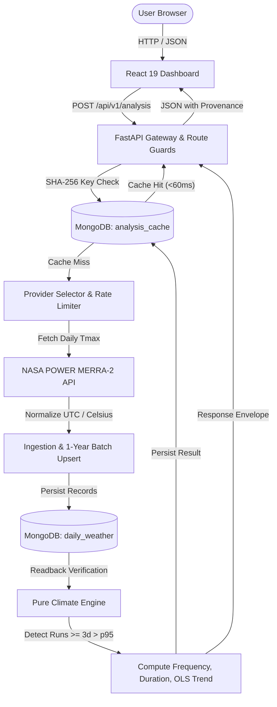

# Climate Hazard Trend Analyzer

A production-grade, full-stack climate analysis platform for detecting historical heatwaves, quantifying annual frequencies and durations, and evaluating multi-decade warming trends from empirical meteorological reanalysis data.

---

### Quick Links

- **API Documentation (Swagger UI)**: [http://localhost:8000/docs](http://localhost:8000/docs)
- **Architecture Specification**: [ARCHITECTURE.md](ARCHITECTURE.md)
- **Scientific Methodology**: [backend/docs/climate-methodology.md](backend/docs/climate-methodology.md)
- **Integration Contract**: [INTEGRATION_CONTRACT.md](INTEGRATION_CONTRACT.md)
- **Continuous Integration Pipeline**: [.github/workflows/ci.yml](.github/workflows/ci.yml)
- **Verification & Test Record**: [docs/verification.md](docs/verification.md)
- **System Design Coverage (All 85 Concepts)**: [docs/system-design-coverage.md](docs/system-design-coverage.md)

---

## 1. Executive Summary & Plain-English Overview

### What does this application do?
The **Climate Hazard Trend Analyzer** allows researchers, municipal planners, and citizens to select any location on Earth (or define a bounding box region) and analyze up to 50 years of historical daily maximum temperatures. The application determines whether heatwaves are becoming more frequent, longer, or more severe over time.

### Why is this challenging?
1. **Raw weather archives are massive and messy**: Decades of daily temperatures contain missing instrument readings, leap days, conflicting timestamps, and provider-specific error codes (like `-999.0`).
2. **Climate definitions must be mathematically precise**: A single hot afternoon is not a heatwave. Science requires an objective, localized threshold that compares current weather against a standardized historical baseline.
3. **Many dashboards invent data**: A common pitfall in web applications is showing smooth, colorful "heatmaps" where no physical weather stations exist. This application prioritizes **truthful scientific provenance**—it presents only empirical reanalysis estimates, explicitly discloses spatial grid resolution, and never hallucinates continuous spatial surfaces.

---

## 2. System Architecture & End-to-End Data Pipeline

The system is designed as an explainable, modular monolith separating user presentation, API gateway validation, provider ingestion, database persistence, and deterministic climate math:



---

## 3. Data Ingestion & Handling: Explained in Plain Words

When a user requests an analysis for a 30-year span (over 10,950 individual calendar days), the system follows a 6-stage engineering pipeline:

### Stage 1: Zero-I/O Strict Validation
Before contacting external weather services or querying the database, the backend checks all parameters:
- Latitude must be between $-85.0^\circ$ and $85.0^\circ$.
- Year spans must be between 1 and 50 full calendar years within provider availability (e.g., 1981–2025 for NASA POWER).
- Bounding boxes cannot exceed $2.0^\circ \times 2.0^\circ$ in geographic span.
- Any malformed or unauthorized parameter is rejected immediately with HTTP 422, protecting database and external network bandwidth.

### Stage 2: Canonical SHA-256 Cache Lookup
Every scientific analysis request generates a unique SHA-256 digital fingerprint based strictly on scientific inputs: coordinates, provider, start year, end year, baseline window, and algorithm version. If this exact request was computed previously, the complete validated result is returned from MongoDB Atlas in under **60 milliseconds**. Display labels (such as place names) do not affect cache identity.

### Stage 3: Fetching from Space Reanalysis
On a cache miss, the backend contacts **NASA POWER** (utilizing the MERRA-2 satellite and assimilation model on a $0.5^\circ \times 0.625^\circ$ grid). If NASA POWER is unavailable or times out, the system automatically falls back to **Open-Meteo ERA5** ($0.25^\circ$ atmospheric reanalysis).

### Stage 4: Cleaning & Normalizing the Data
Raw provider responses are cleaned through strict normalization rules:
- **Missing values**: NASA POWER returns `-999.0` when data is missing. The normalizer detects this and converts it to a genuine null (`None`).
- **Calendar days**: All timestamps are canonicalized to strict UTC dates (`YYYY-MM-DD`).
- **Leap years**: February 29th is preserved and aligned across all leap years.
- **Unit standardization**: Temperatures are validated and guaranteed in degrees Celsius (°C).

### Stage 5: Chunked 1-Year Database Persistence
Writing 10,000 to 18,000 daily records in a single database transaction can trigger MongoDB driver timeouts (`timeoutMS` threshold). To make writes rock-solid:
- The system stores records in **1-year batches** (~365 days per batch).
- Each batch takes ~140 ms to upsert into MongoDB.
- Daily records are indexed by `(source_key, date)` ensuring idempotency—repeating the request never creates duplicate rows.

### Stage 6: Mandatory Readback Verification
The climate engine **never** computes results directly from raw network packets. Instead, it reads the saved records back from MongoDB. If any day in the requested historical window is missing or corrupted, the system detects the coverage gap, halts calculation, and reports an honest data warning to the user rather than producing inaccurate trends.

---

## 4. The Science: How Heatwaves and Trends Are Detected

### 1. The 30-Year Historical Baseline (1991–2020)
To know whether today is abnormally hot, we must know what "normal" was. The application uses the World Meteorological Organization (WMO) standard 30-year climatological baseline: **1991 through 2020**.
- All valid daily maximum temperatures across those 30 years are collected (~10,950 observations).
- The system calculates the **95th percentile temperature ($p95$)** using linear interpolation.
- *In simple terms*: 95% of days during that 30-year period were cooler than this number; only the top 5% hottest days exceeded it. For example, in New Delhi, the baseline $p95$ threshold is **44.7 °C**.

### 2. Identifying Heatwave Events
- A **heatwave event** is strictly defined as **at least 3 consecutive calendar days** where the daily maximum temperature strictly exceeds the baseline $p95$ threshold ($T_{\text{max}} > p95$).
- A 2-day hot spike is not a heatwave.
- A day equal to the threshold ($T_{\text{max}} = p95$) does not qualify.
- Any missing or invalid temperature reading breaks the run.

### 3. Measuring Event Severity & Duration
For every detected heatwave event, the engine records:
- **Start Date** and **End Date** (UTC).
- **Duration**: Total consecutive days.
- **Mean Excess (°C)**: Average degrees above the threshold ($T_{\text{max}} - p95$).
- **Peak Excess (°C)**: Highest temperature recorded during the run above the threshold.
- **Boundary Censoring**: If an event began before the requested analysis window or was still ongoing when the window closed, it is flagged as `boundary_censored: true` to inform the user that its full duration was partially truncated.

### 4. Evaluating Multi-Decade Trends
- **Annual Event Frequency**: How many distinct heatwaves started in each calendar year.
- **5-Year Rolling Average**: A smoothed curve eliminating single-year weather anomalies.
- **Ordinary Least Squares (OLS) Regression**: If at least 10 eligible years are analyzed, the system fits a linear slope to the annual frequency. It classifies the trend as **increasing**, **decreasing**, or **stable**.
- **No False Significance**: The response explicitly discloses `significance_tested: false`. Without rigorous autocorrelation modeling, stating a p-value would be misleading.

---

## 5. Bounding Box Regional Sampling & Cosine Weighting

When analyzing a geographic area rather than a single point, weather conditions vary across the terrain. 

```
North-West (lat2, lon0) --- North-Center (lat2, lon1) --- North-East (lat2, lon2)
       |                             |                           |
 Mid-West   (lat1, lon0) ---  Mid-Center  (lat1, lon1) ---  Mid-East   (lat1, lon2)
       |                             |                           |
South-West (lat0, lon0) --- South-Center (lat0, lon1) --- South-East (lat0, lon2)
```

1. **3×3 Cell-Center Grid**: The bounding box is divided into 9 equal geographic cells. The exact geographic center of each cell is sampled:
   $$\text{lat}_i = \text{south} + (2i + 1)\frac{\Delta\text{lat}}{6}, \quad \text{lon}_j = \text{west} + (2j + 1)\frac{\Delta\text{lon}}{6}$$
2. **Cosine-Latitude Weighting**: Because meridians converge at the poles, a degree of longitude represents less surface area near the poles than at the equator. The system normalizes weights using the cosine of latitude:
   $$w_k = \frac{\cos(\text{radians}(\text{lat}_k))}{\sum_{m=1}^9 \cos(\text{radians}(\text{lat}_m))}$$
3. **Grid-Cell Deduplication**: If multiple sample points resolve to the exact same weather model cell (e.g. in Open-Meteo), their weights are mathematically combined rather than making redundant external calls.
4. **Honest Spatial Disclosure**: The frontend displays all 9 sample coordinates and explicitly warns the user that this is an area-averaged regional sample, **not** an interpolated station heatmap.

---

## 6. Key Implemented Features

| Feature | Description | File Reference |
|---|---|---|
| **Point & Place Search** | Autocomplete geocoding with disambiguation and manual coordinate inputs. | [`frontend/src/components/AnalysisControls.tsx`](frontend/src/components/AnalysisControls.tsx) |
| **Bounding Box Area** | Constrained rectangular bounding box selection with coordinate validation. | [`frontend/src/form.ts`](frontend/src/form.ts) |
| **Monochrome UI** | Accessible high-contrast black/white design system meeting WCAG 2.2 AA. | [`frontend/docs/design.md`](frontend/docs/design.md) |
| **Scalable SVG Charts** | Hand-crafted SVG charts (Frequency, Duration, Anomaly) with data tables. | [`frontend/src/components/LineChart.tsx`](frontend/src/components/LineChart.tsx) |
| **Heatwave Calendar** | Every backend event drawn by year and day of year; hover links all charts, and selecting a year opens its values and events. | [`frontend/src/components/HeatwaveCalendar.tsx`](frontend/src/components/HeatwaveCalendar.tsx) |
| **Maps** | Leaflet result map of the analysed point, provider-reported cell or box with its 9 sample points, and a map picker for points and boxes; dark grayscale OpenStreetMap tiles, no intensity shading. | [`frontend/src/map/maps.tsx`](frontend/src/map/maps.tsx) |
| **Fast Start** | Wakes the sleeping free-tier API on page load, reuses saved results within their expiry and shows only real loading stages. | [`frontend/src/hooks/useServerStatus.ts`](frontend/src/hooks/useServerStatus.ts) |
| **Heatwave CSV Export** | Client-side RFC 4180 CSV export of all detected heatwave events. | [`frontend/src/components/ResultsView.tsx`](frontend/src/components/ResultsView.tsx) |
| **Dual Provider Fallback** | NASA POWER primary with automatic failover to Open-Meteo ERA5. | [`backend/app/selector.py`](backend/app/selector.py) |
| **Dual MongoDB Caching** | Persistent daily weather storage + SHA-256 analysis result cache. | [`backend/app/repositories/`](backend/app/repositories/) |
| **Operational Benchmark** | Concurrency and latency load testing tool reporting p50 and p95 metrics. | [`scripts/benchmark.py`](scripts/benchmark.py) |
| **Full CI/CD Pipeline** | Automated GitHub Actions workflow testing docs, backend, and frontend. | [`.github/workflows/ci.yml`](.github/workflows/ci.yml) |

---

## 7. Local Setup & Quickstart Guide

### Prerequisites
- **Python**: Version 3.12 or 3.14 (managed via `uv` or standard venv).
- **Node.js**: Version 22+ or 24 LTS.
- **MongoDB**: MongoDB Atlas connection string (or a local MongoDB instance on port 27017).

---

### Step 1: Clone & Configure Environment

```bash
git clone <repository-url>
cd "Climate Hazard Trend Analyzer"
```

Configure backend secrets in `backend/.env`:

```ini
# backend/.env
MONGODB_URI=mongodb+srv://<username>:<password>@cluster0.mongodb.net/?appName=Cluster0
ALLOWED_ORIGINS=http://localhost:5173,http://127.0.0.1:5173
WEATHER_PRIMARY_PROVIDER=nasa_power
```

---

### Step 2: Start the Backend Service

```bash
cd backend

# Install locked dependencies using uv
uv sync

# Run the FastAPI server on port 8000
uv run uvicorn app.main:create_app --factory --port 8000 --reload
```

*The interactive OpenAPI Swagger documentation is available at [http://localhost:8000/docs](http://localhost:8000/docs).*

---

### Step 3: Start the Frontend Application

In a separate terminal:

```bash
cd frontend

# Install clean pinned dependencies
npm ci

# Start the Vite development server
npm run dev
```

*Open your browser at [http://localhost:5173](http://localhost:5173) to view the dashboard.*

---

## 8. Verification & Quality Assurance Suite

All tests can be executed locally using the following commands:

### Backend Test Suite (271 Tests)
```bash
cd backend
uv run ruff check .
python -m compileall app
uv run pytest -m "not live_external"
```

### Frontend Test & Build Suite (102 Tests)
```bash
cd frontend
npm run typecheck
npm run lint
npm test
npm run build
```

### Documentation & Concept Matrix Checker
```bash
# Validates all 61 Markdown docs, 85 concepts, 28 requirements, and token contrast ratios
python scripts/check_docs.py --self-test
python scripts/check_docs.py
```

### Operational Benchmark & Load Testing
```bash
# Benchmark health and synchronous analysis latency across 5 concurrent workers
python scripts/benchmark.py --url http://127.0.0.1:8000 --concurrency 5 --iterations 10
```

---

## 9. Performance Budgets & Operational Metrics

| Metric | Target Budget | Measured Reality |
|---|---|---|
| **Cold Request Latency** (30-year span, live NASA fetch + Atlas persistence) | <90.0 s | **2.74 s** |
| **Warm Cached Request Latency** (Atlas cache read) | <1.0 s | **57.5 ms** (Atlas) / **7.7 ms** (Local) |
| **Frontend JavaScript Bundle Size** (production compressed) | <250 kB gzip | **86.03 kB gzip** initial, plus a lazy 44.53 kB map chunk |
| **Frontend CSS Size** | <10 kB gzip | **3.67 kB gzip** initial, plus 6.36 kB with the maps |
| **Automated Accessibility Violations** (`axe-core`) | 0 | **0 violations** |
| **Responsive Viewports Tested** | 9 viewports | **All 9 pass without layout overflow** |

---

## 10. Security & Hardening Controls

- **No Secrets in Source Control**: `backend/.env` is strictly gitignored; only `backend/.env.example` is tracked.
- **Exact CORS Allowlist**: Only explicitly listed browser origins in `ALLOWED_ORIGINS` are granted HTTP access.
- **Strict Inbound Rate Limiting**: Enforced per-IP fixed windows (`5 analyses / min`, `30 place searches / min`) returning standard `429 Too Many Requests` with a `Retry-After` header.
- **Information Leakage Prevention**: Production unhandled exceptions return a generic JSON error envelope with an anonymous `request_id`. Server stack traces and internal database error messages are never sent to the client.
- **Request Body Capping**: Inbound HTTP request payloads are strictly capped at 100 kB to prevent Denial-of-Service memory exhaustion.

---

## 11. Assumptions, Data Limitations & Provenance

1. **Reanalysis vs. Ground Weather Stations**: Meteorological data from NASA POWER (MERRA-2) and Open-Meteo (ERA5) are modeled numerical reanalyses gridded at $0.25^\circ$ to $0.5^\circ$. They represent average regional atmospheric conditions and do not reflect micro-climatic variations, such as localized urban heat island effects.
2. **Fixed Annual Baseline vs. Day-of-Year**: A fixed 30-year all-season 95th percentile ($p95$) identifies absolute seasonal heat extremes (e.g. summer heatwaves). It does not detect unseasonal warmth during winter or shoulder seasons.
3. **Descriptive Trends**: Trend slopes are descriptive Ordinary Least Squares estimates. The application explicitly flags `significance_tested: false` because formal statistical significance requires specialized autocorrelation models.

---

## 12. AI Tooling & Development Disclosure

In accordance with academic and engineering transparency standards:
- **Pair Programming Assistance**: Google DeepMind's Antigravity agentic coding assistant and Claude Code were used for test suite design, documentation reconciliation, refactoring assistance, and type checking.
- **Human Authorship & Authority**: All architectural decisions, scientific methodology formulas, safety controls, and commit scopes were specified, reviewed, and authorized per the project workflow outlined in [docs/ai-development-workflow.md](docs/ai-development-workflow.md).
