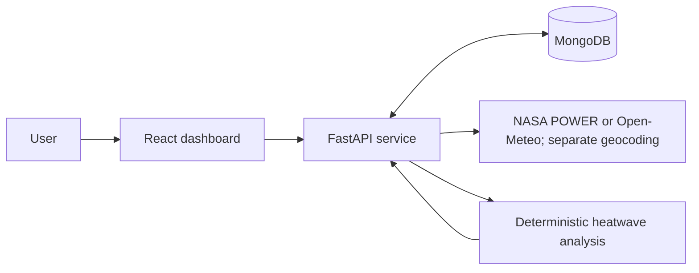

# Climate Hazard Trend Analyzer

A planned web application for exploring historical heatwave frequency, duration, and temperature patterns for a selected location. The intended result is an understandable climate analysis with visible methodology and data limitations.

**Current state (2026-10-14): architecture/design/workflow documented; backend connectivity is partial.** The 85-concept documentation pass is tracked in DOC-003. Backend settings, Atlas lifecycle and health routes have draft code and locked dependencies; application tests and successful Atlas connectivity are still pending. No dashboard, provider adapters, persistence repositories, climate engine or deployment exists. See [verified state](PROJECT_STATE.md) and [current audit](docs/system-design-audit.md).



The backend will normalize weather records, persist and reread them, calculate results, and cache summaries. The frontend will render those summaries without duplicating scientific calculations. Developer skills and optional AI tools are outside this runtime.

## Read first

| Document | Purpose |
|---|---|
| [PRD](PRD.md) | Requirements, provenance, success criteria and scope |
| [Architecture](ARCHITECTURE.md) | Boundaries, request flow and trade-offs |
| [Integration contract](INTEGRATION_CONTRACT.md) | Proposed request/response and error schemas |
| [Product context](PRODUCT.md) / [design](frontend/docs/design.md) | Durable product facts / canonical monochrome visual direction |
| [Tasks](TASKS.md) | Ordered milestones and links to repository tasks |
| [85-concept coverage](docs/system-design-coverage.md) / [alignment audit](docs/system-design-audit.md) | Concept-to-document/task/test traceability and current gaps |
| [AI development workflow](docs/ai-development-workflow.md) / [CI plan](AI_WORKFLOW.md) | Six roles, approvals, verification/review and task completion |
| [Documentation index](docs/README.md) | Audit, tool evaluation, decisions and verification |
| [Frontend](frontend/README.md) / [backend](backend/README.md) | Independent implementation areas and local rules |

## Setup and verification

[Backend README](backend/README.md) documents the existing uv environment, lint/compile checks and conditional startup command. Live Atlas connectivity failed, so startup is not verified. Frontend commands do not exist yet; do not guess npm scripts or start a public listener.

The documentation checker is available now, from this workspace root:

```powershell
python scripts/check_docs.py --self-test
python scripts/check_docs.py
```

## Repository ownership

One root Git repository contains `frontend/`, `backend/` and the shared documents ([DOC-002](TASKS.md)); never create nested repositories or submodules. Branch `main` has no commits and no remote yet. Repository URLs remain unset, not fabricated.

## AI disclosure and submission

Codex read the private brief and user prompts, inspected this workspace and installed tool metadata, researched official documentation, and authored/reviewed this foundation. PDF, OpenAI Docs and plugin-management skills were used; external engineering/design guidance was read and applied manually. No external AI gateway was installed or used. Codex also drafted backend connectivity/settings/health code, locked its dependencies and probed public weather endpoints without API keys. Claude Code (Claude Opus) later fixed and tested the backend connectivity foundation, implemented request/error/source schemas (contract 0.2) and both weather-provider adapters, and scaffolded the frontend shell, with tests run and recorded in [verification](docs/verification.md). No live climate result, analysis dashboard or deployment has been produced.

Before submission: implement and verify the core pipeline; provide public code repository links and deployed URL; document setup, data sources, assumptions, limitations and actual AI assistance. The deadline and submission link were not supplied. Keep the confidential brief out of public repositories. Demo video and exports are optional after the core works.
