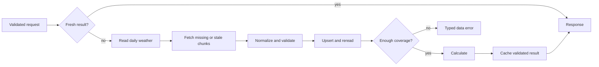

# Ingestion, normalization and cache lifecycle

This document owns pipeline behavior; [methodology](climate-methodology.md) owns calculations and [database](database.md) owns document/index shapes.

1. Validate request, rate limit and calculate an upper bound on years, points and source calls before external I/O.
2. Canonicalize region coordinates and scientific cache key. Query a current analysis record with explicit expiry/method checks.
3. On miss acquire a bounded per-key in-process lock, then recheck. Wait only inside the 90s deadline; refuse excess work with CAPACITY_EXCEEDED.
4. Determine the union of selected and baseline dates for each source series; avoid double-fetching overlapping years. Read unexpired persisted records.
5. Select an eligible source covering the complete required baseline/analysis interval. Reuse only that source's compatible records and fetch missing/stale chunks from fixed hosts. If switching sources, acquire the entire required range for the alternate source (or its independently valid cache); never patch primary-source gaps with alternate values. Maximum two source calls concurrently per process initially. Total attempts count toward request/provider budgets.
6. Check HTTP status, response content length, array shape, date interval, units, finite values, resolved coordinates and metadata. Apply [normalization](climate-methodology.md). Malformed structure => PROVIDER_ERROR, not fabricated null-filled success.
7. Upsert validated/negative records idempotently. Reread persisted rows and verify expected coverage before analysis. Database failure => STORAGE_UNAVAILABLE; do not return an unstored production result.
8. Build regional-day baseline/analysis series, enforce quality gates, detect events and aggregate metrics. Baseline failure => INSUFFICIENT_BASELINE; no eligible analysis years => INSUFFICIENT_DATA.
9. Validate response invariants, attach source/quality/warnings and save analysis cache with source fingerprint and expiry invariant.
10. Return a new request ID and current display label, retaining original source/generated timestamps on hits.

## Provider interface and resilience

Proposed interface: fetch daily maxima for one canonical point and inclusive date range, returning normalized rows plus source metadata. The service supplies the complete required interval, including the fixed baseline. Geocoding is a separate fixed-host adapter operation. Do not let routes assemble arbitrary URLs or let scientific functions call the provider. Adapters exist in app/providers/ (BE-003) and return `DailySeries` from app/ingestion.py; the selector (BE-010) and cache do not exist yet. Callers create the shared `httpx.AsyncClient`; it should use `trust_env=False` so environment proxies or `.netrc` credentials never reach providers.

Default one retry (two attempts); configuration permits at most two retries. Retry transient network/timeouts, 429 and selected temporary 500/502/503/504 responses, not permanent 4xx/authentication, unsupported parameters, malformed JSON or unusable schema. Use bounded exponential delay with jitter (initial 0.5s), respecting integer/date Retry-After only when it fits the remaining monotonic budget. Default attempt timeout 10s; default entire provider-selection budget 60s, bounded by the service's remaining 90s total including DB work. HTTP-library read timeout alone is not an overall deadline. Cancelled requests must release slots/locks and must not initiate fallback.

Cap each archive response at 5 MiB and validate before parsing excessively large data. Plan at most 80 distinct weather years per point for the union of analysis and baseline, at most nine sample points, and at most 2400 attempts as a mathematical ceiling; the 90s deadline, process concurrency and provider quota budget normally stop much earlier. Before the box slice, measure this cold path and constrain requests further if it cannot meet budgets. Never launch all chunks at once.

## Cache correctness and concurrency

Use one explicit canonical serializer and tests for changed coordinates, periods, baseline, timezone, method and quality policy. Normalize numeric representation before hashing. Do not use region name alone. An in-memory result cache is unnecessary because MongoDB already persists results.

Process-local single-flight prevents identical misses inside one worker; independent scientific requests remain bounded by shared concurrency. Bounded limiter/lock maps must expire entries to prevent memory growth from arbitrary coordinates/clients. Unique DB upserts protect data across restarts, but do not prevent duplicate provider spend across workers. Scaling past one worker requires a documented coordination/edge-limiting change.

TTL indexes are cleanup mechanisms, not correctness mechanisms. Every lookup checks freshness. Negative records expire faster than valid records; a partial result expires at or before its shortest-lived source. Errors are not cached as successful analyses. No stale fallback unless a future contract explicitly labels age and reason.

## Provider eligibility, access and evidence

This section is the provider-policy authority (concepts 25, 43, 45–54). Settings and adapters exist; orchestration (BE-010) remains planned. Official docs and minimal live probes were checked on 2026-10-13; public deployment eligibility must be reviewed again for the actual use.

| Source | Endpoint / variables | Coverage and conventions | Access and role |
|---|---|---|---|
| NASA POWER | `https://power.larc.nasa.gov/api/temporal/daily/point`; `T2M_MAX`, community AG, JSON, explicit `time-standard=UTC` | Daily UTC documented from 1981; 1990–2020 probe reported MERRA2/POWER, Celsius, all expected days. Meteorological source grid is coarse (MERRA-2 approximately 0.5 latitude x 0.625 longitude); returned point coordinates are not proof of cell-center identity | Public no-key request succeeded; preferred eligible source under latest user direction |
| Open-Meteo | `https://archive-api.open-meteo.com/v1/archive`; `daily=temperature_2m_max`, `models=era5`, Celsius, GMT | ERA5 documented from 1940, approximately 0.25-degree grid; 1990–2020 no-key probe returned complete Celsius/GMT data | Free endpoint limited to non-commercial use/quotas; local assessment fallback only while usage meets those conditions |

Sources: [NASA daily API](https://power.larc.nasa.gov/docs/services/api/temporal/daily/), [NASA meteorology](https://power.larc.nasa.gov/docs/methodology/meteorology/), [NASA data FAQ](https://power.larc.nasa.gov/docs/faqs/data/), [Open-Meteo historical API](https://open-meteo.com/en/docs/historical-weather-api), [free-service terms](https://open-meteo.com/en/terms). Attribution must identify the actual source; no uptime or scientific interchangeability is promised.

Both probes used latitude 28.6139, longitude 77.209, 1990-01-01 to 2020-12-31 and returned HTTP 200 with 11,323 values, matching first/last dates, no missing/fill values and all values inside the broad -90..65 C plausibility bounds. NASA explicitly reported UTC; Open-Meteo reported GMT and zero offset. This establishes access and basic shape at one point/period, not global correctness, adapter acceptance or a heatwave result. Raw probes did not exercise normalization, all duplicate/date-sequence cases, fallback or caching.

Settings are listed in [security](security.md) and [.env.example](../.env.example). No API key variables or paid/credential provider is allowed. Unknown provider/host, non-UTC NASA or non-ERA5 Open-Meteo configuration must fail before network use. If free usage is unsuitable, disable Open-Meteo; the app then has only one eligible source. No account signup is required for these public probes.

## Whole-source selection and quality

1. Validate coordinates, date order/span and hazard independently of provider outcomes. Invalid user input never invokes fallback.
2. Determine union of selected and baseline dates. Check source coverage/availability, fixed model and usage eligibility. A request beginning before NASA's coverage is ineligible for NASA; it may use a suitable ERA5 source, without first making a doomed NASA request.
3. Attempt preferred eligible source within remaining deadlines and quota. Validate status, bounded body, JSON shape, finite coordinate metadata, date range/order/count, duplicate behavior, units and UTC convention.
4. Normalize missing/null/fill/invalid values explicitly. The proposed 95% overall valid-day minimum is an adapter usability guard, not sufficient scientific acceptance: check each baseline year's 90% and each month's 80% gates. Preserve gaps for run detection; never interpolate. Analysis-year exclusions remain governed by methodology rather than fabricated continuity.
5. On unusable primary data or exhausted transient retries, attempt the next eligible provider for the entire required dataset. No NASA/ERA5 mixing, including the baseline. A source switch changes reference threshold and cache fingerprint and must be disclosed through an approved source contract.
6. All eligible sources failed: return a safe provider/timeout/insufficient-data error according to cause; no result record is created. The contract does not authorize stale-result fallback. Persist/read back only after valid source selection through the eventual repository layer.

The internal normalized-series design carries source/provider/model, source-grid dimensions, requested point, genuinely resolved point when known, UTC convention, Celsius unit, retrieval time, coverage/duplicate diagnostics and normalization version. Do not infer a NASA cell center from coordinates echoing the requested point. The public source object is defined by contract 0.2 ([DOC-004](../../TASKS.md)).

Duplicate-request cache reuse and failure-not-cached tests require BE-005 / BE-007; a stub cache test cannot satisfy them. BE-010 tests only transport/selector behavior until those prerequisites exist. No ingestion, repository or climate module is created in this documentation phase.
