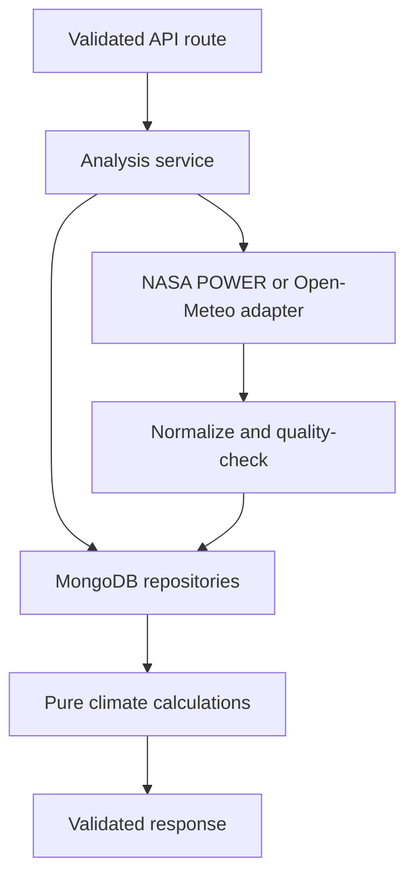
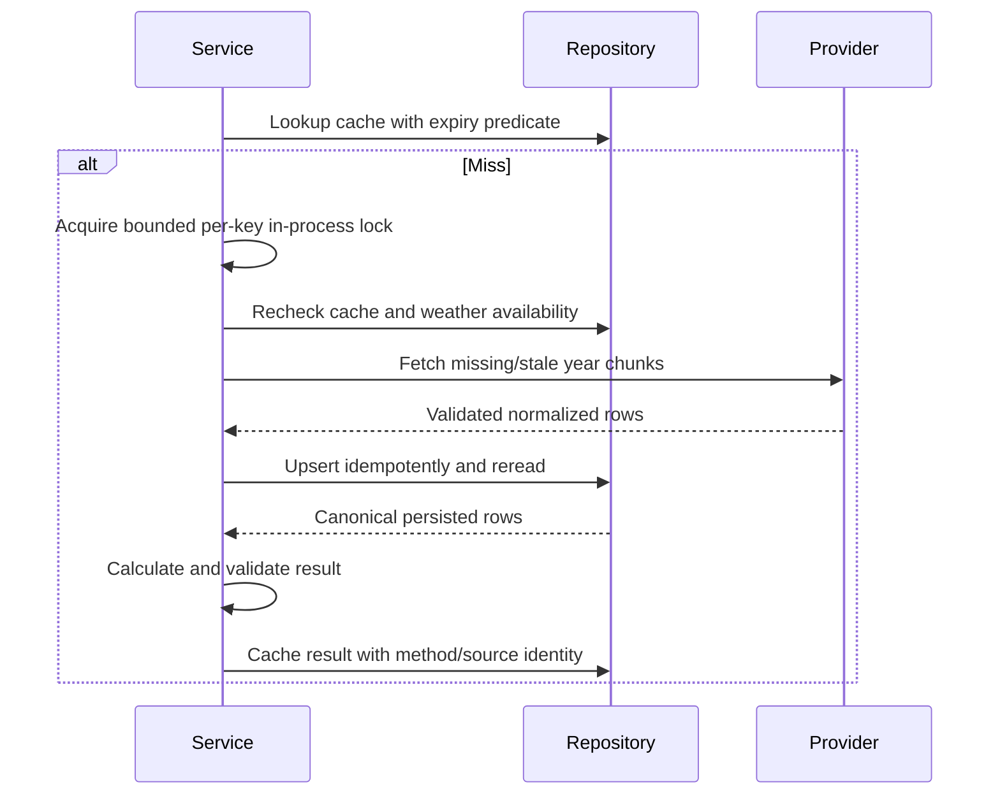
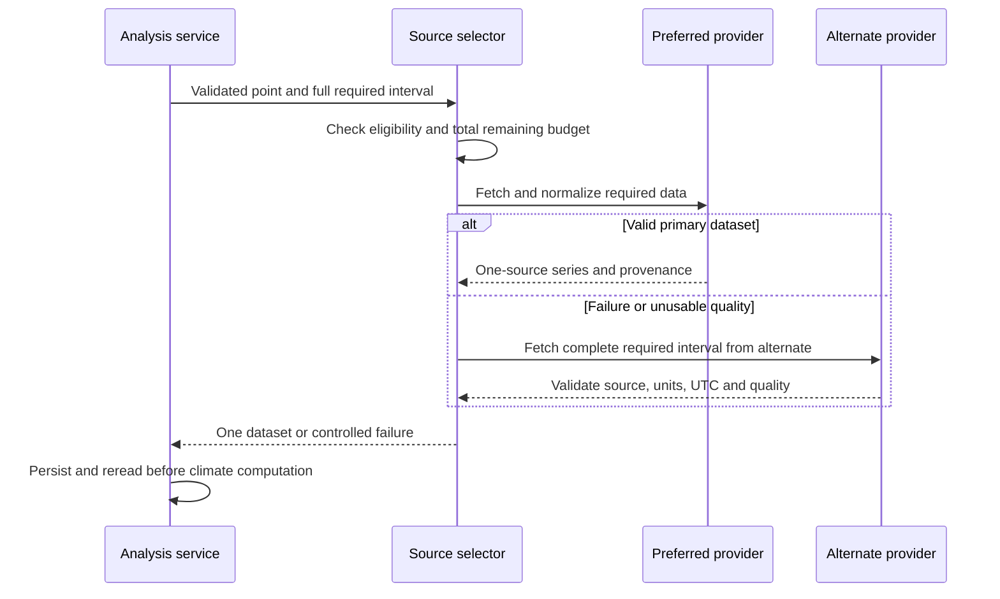
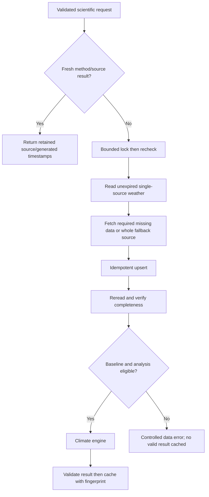
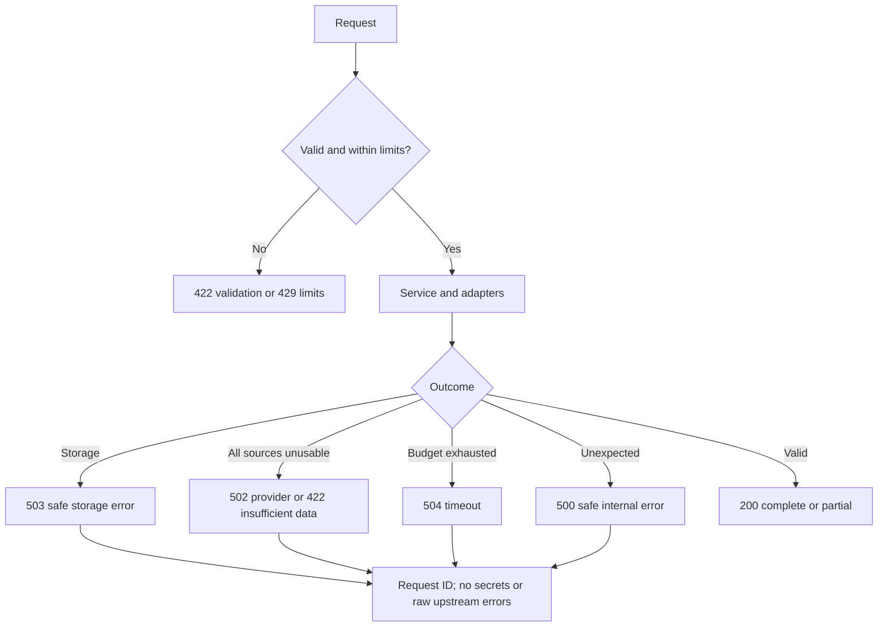
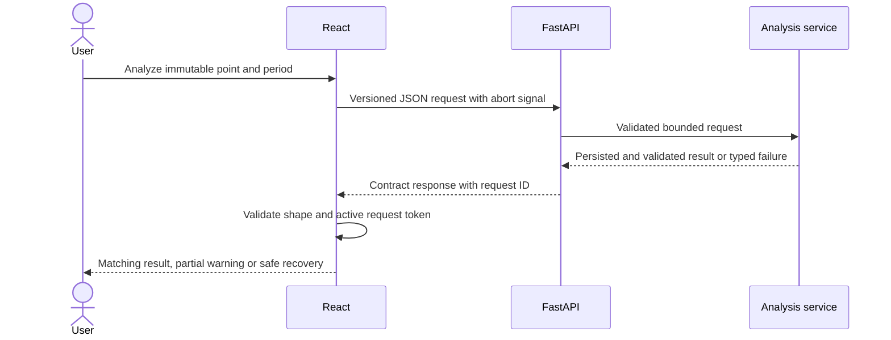

# Backend system design and architecture

System design assigns ownership so a provider change does not alter scientific logic, and a UI error does not hide data-quality failure. Use one modular service, not microservices: the assessment needs bounded HTTP processing, persistence and explainable calculations, not independent deployments.

## Planned modules

| Location (proposed) | Responsibility | Why separate |
|---|---|---|
| `app/main.py`, `app/api/` | Lifespan, routes, error handlers | HTTP semantics stay outside science |
| `app/schemas.py` | Validated requests/responses | One backend wire authority |
| `app/services/analysis.py` | Orchestrate one analysis | Keeps routes small and testable |
| `app/providers/open_meteo.py` | Fixed-host HTTP and shape checks | Replace provider without rewriting detector |
| `app/ingestion.py` | Normalize dates/units/quality | Shared canonical input for cache/domain |
| `app/climate.py` | Threshold, runs, yearly metrics, descriptive slope | Deterministic fast tests without services |
| `app/repositories/weather.py`, `analysis.py` | MongoDB access and indexes | Safe, indexed queries in one place |
| `app/settings.py` | Validated environment and limits | Clear startup failure and safe defaults |

These are planned locations, not empty directories to create in advance. Existing code covers settings, database lifecycle, health routes, schemas, ingestion and provider adapters; see [state](state.md). Ordinary functions and small adapters suffice; no generic repository superclass or dependency-injection framework beyond FastAPI dependencies. The provider-selector design lives in [pipeline](data-pipeline.md); adapters exist, the selector does not.

## Reliability, load and state

Inputs have bounded years, points and lengths; use linear passes over sorted daily arrays plus one percentile sort. Avoid pandas unless data handling warrants it; NumPy is proposed for explicit percentile behavior and arrays. OLS can use small tested numerical functions without adding SciPy solely for a slope. No significance test is implied.

Database uniqueness makes repeated ingestion idempotent. Cache-aside means first check stored results, then calculate and store on miss. [Pipeline](data-pipeline.md) specifies freshness and race handling. Cache identity includes every scientific choice; omitted baseline/model parameters cause wrong reuse.

Clients do not hold server sessions. Database state survives restarts; process-local locks/limiter state do not. One worker is the initial deployment constraint. Concurrent misses are coalesced in-process, while unique indexes preserve data integrity even after a restart. Additional replicas need shared budgets/coordination before scale claims.

Use a shared async HTTP client, MongoDB connection pool and small concurrency semaphore. Propagate total request deadlines through chunk retries and persistence. Return a controlled capacity error rather than allocating an unbounded queue. Logs/metrics expose latency, cache hits, upstream calls, invalid rows and error codes without sensitive input.

Unit tests inject normalized samples into pure functions; service tests use narrow provider/repository doubles; separate integration tests use a real MongoDB and isolated data. Dependency injection exists at these real I/O boundaries, not every function. [Testing](testing.md) defines evidence.

Potential bottlenecks: cold baseline ingestion, many distinct coordinates, provider quotas and slow database indexes. Measure first. Queues are only justified if bounded supported work cannot finish synchronously; Redis/distributed locks require multi-instance demand. Deployment design must recheck host timeout/cold-start limits and MongoDB networking. No measured throughput or production-readiness claim exists.

## Concept implementation guide (22–34)

The [coverage matrix](../../docs/system-design-coverage.md) supplies complete IDs/tasks and distinguishes design from implementation. This guide specifies owners, acceptance and trade-offs without duplicating wire schemas or scientific formulas.

| ID / concept | Meaning and project reason | Owner, approach and boundary | Acceptance / test / task | Trade-off / security or performance implication |
|---|---|---|---|---|
| 22 Layered architecture | Separate change reasons so source changes do not rewrite routes or science | API -> service -> repository/provider/domain; domain imports no I/O | Import review and service tests; BE-001, BE-007 | No generic layer framework |
| 23 REST API | Predictable HTTP interface for the single-page client | Versioned routes and contract-defined errors; synchronous bounded POST | CONTRACT-INPUT/OUTPUT; BE-001, BE-004, BE-007 | Jobs require a future contract, not implicit polling |
| 24 Request validation | Reject bad or excessive work before spending provider/DB resources | Strict Pydantic schemas; point first; bounded dates/labels/area | Invalid request makes zero I/O; BE-001, BE-006 | UI validation is guidance, not enforcement |
| 25 Provider adapters | Isolate distinct external payloads behind daily-series results | Fixed-host NASA and ERA5 adapters; explicit source metadata | PROVIDER-NORMALIZE; BE-003 | HTTPX suffices; no provider SDK needed |
| 26 Ingestion pipeline | Transform source data into reliable persisted input | Service requests, normalizes, persists, rereads; repositories own writes | Partial-write recovery and E2E-ANALYSIS; BE-007 | No successful unstored production result |
| 27 Climate engine | Keep numerical results deterministic and reviewable | Pure app/climate.py accepts explicit dates/normalized series | Independent CLIMATE-BASELINE/RUNS/TREND; BE-002 | No network, database or implicit live clock |
| 28 Normalization | Make dates, units and quality comparable within one source | Adapters normalize to Celsius/UTC with disjoint missing/invalid diagnostics | Duplicates, units, invalid and gaps; BE-003 | Never infer quality from HTTP 200 |
| 29 Error handling | Fail safely and consistently at each boundary | Typed domain exceptions mapped by API; safe request ID and code | Redaction/status tests; BE-001, BE-008, BE-009 | Public response cannot expose raw exceptions |
| 30 Idempotency | Repeating an interrupted ingestion must not duplicate observations | Unique source/date key, upsert and persisted readback | Real DB duplicate/restart/partial-write tests; BE-005, BE-007 | Indexes protect data, not provider-call spend |
| 31 Async processing | Await external I/O without blocking all users | Shared async HTTP and PyMongo clients, bounded semaphore/deadline | Delayed I/O/cancel/close tests; BE-003, BE-009 | CPU-heavy science may need offload only after measurement |
| 32 Dependency injection | Substitute real I/O boundaries in tests | Lifespan client ownership, FastAPI dependency, service constructor arguments | Fake-client failures and separate live evidence; BE-001, BE-009 | Avoid injecting every pure helper |
| 33 Background jobs | Durable deferred execution is optional complexity | Defer until supported cold requests repeatedly exceed deadline after caching | Measured trigger review, ADR-018; BE-011 | Would require job persistence, cancellation and API revision |
| 34 API versioning | Consumers need stable meanings while scientific versions evolve | Contract/schema revision together; method/cache versions tracked separately | Contract 0.2 approved (DOC-004); frontend fixtures in FE-002 | Source metadata change cannot be hidden in existing literals |

## Data and resilience guide (35–54)

| ID / concept | Need and module ownership | Approach and acceptance / tests | Trade-off / task |
|---|---|---|---|
| 35 Atlas modeling | Repositories represent observations/results, not arbitrary documents | Proposed [database model](database.md); validate shape and real readback | No collections in this phase; BE-005 |
| 36 Indexing | Weather/cache lookup must remain bounded | Unique keys plus TTL; explain plans and duplicate/TTL-lag cases | TTL is cleanup, not freshness; BE-005 |
| 37 Integrity | Service must not analyze attempted or conflicting writes | Schema/normalization checks and complete persisted readback; interruption tests | Whole dataset validity matters; BE-003, BE-005, BE-007 |
| 38 Persistent caching | Repository reuse must survive process restarts | Expiry-aware observation reads; restart integration test | Memory cache is not a substitute; BE-005 |
| 39 Result caching | Avoid repeated expensive science/source calls | Validate before save; repeat request and failed-result tests | No success record for errors; BE-005, BE-007 |
| 40 Invalidation | Method/source updates change results | Expiry no later than observations; source revision invalidates dependents | Test stale hit prevention, not just TTL; BE-005 |
| 41 Cache keys | Same label is not necessarily the same science | Canonical coordinates, period, baseline, source and versions; field-change tests | Display label excluded; BE-005 |
| 42 Concurrency | Concurrent misses must not multiply work | Bounded single-flight, recheck after lock, cleanup on cancellation | One worker only until shared enforcement; BE-007, BE-008 |
| 43 Provenance | ERA5 and NASA have different grids and daily-source semantics | Series retains source/model/grid/UTC/retrieval; response never mislabels | Contract 0.2 defines the response; BE-003, BE-005 |
| 44 Retention | Finite storage and controlled freshness | Explicit durations, expiry predicates, size monitoring and recovery | Durations provisional; BE-005, BE-011 |
| 45 Fallback | Recover from one provider outage honestly | Eligible ordered sources; discard incomplete source choice and fetch whole required range | Failure/fallback tests; BE-010 |
| 46 Timeouts | Slow DNS/read/DB cannot hold work indefinitely | Total monotonic deadline plus per-operation limits; stall tests | Current DNS stall unresolved; BE-003, BE-009, BE-008 |
| 47 Retries | Transient failures merit limited recovery | Default one retry, max two; 429/timeouts/selected 5xx only; exact-count tests | Bad input/schema/auth not retried; BE-003, BE-010 |
| 48 Backoff | Retries should not amplify outages | Inject clock/sleeper; bounded exponential delay/jitter and Retry-After budget | No sleeping beyond deadline; BE-003, BE-010 |
| 49 Circuit breaker | Avoid repeated outage spend only when evidence warrants | Deferred ADR-018; review failure rates and cost before implementation | Stateful breaker adds recovery complexity; BE-011 |
| 50 Rate limiting | Protect public service and free source quotas | Per-client limits, shared source cap and total budget; spoofed-proxy/load tests | NAT/IP limits imperfect; BE-008 |
| 51 Degradation | Preserve useful truthful behavior on failures | Full-source fallback, warnings, safe errors; no stale result under the contract | Missing DB stops analysis; BE-010, FE-003 |
| 52 Provider health | Observe reliability without wasting free quota | Per-request outcomes/latencies, manual smoke evidence; metric tests | No recurring monitor launched; BE-011 |
| 53 Consistency | One analysis must share source/model/time convention | Same source for baseline plus selected interval; fingerprint changes on fallback | No NASA/ERA5 gap filling; BE-010, BE-007 |
| 54 Partial data | Incomplete observations must not create false events | Baseline/year/month gates, explicit missing days and null excluded years | Overall 95% alone insufficient; BE-002, BE-003, FE-003 |

## Scientific guide (55–64)

[Climate methodology](climate-methodology.md) is the sole formula/quality authority. The following gates make its ownership explicit; no algorithm is implemented yet.

| Concept | Owner and purpose | Acceptance / independent test | Trade-off / task |
|---|---|---|---|
| 55 Heatwave algorithm | Pure detector finds maximal strictly-above-threshold runs | Equality and 2/3/final-day runs, missing separators | At least three days; BE-002 |
| 56 Percentile baseline | Baseline function calculates fixed 1991–2020 annual p95 | Hand-computed linear interpolation and baseline quality failures | No seasonal adjustment in this version; BE-002 |
| 57 Temporal aggregation | Annual function attributes starts and heatwave days correctly | Cross-year event counted once; daily allocation and leap test | Whole-event duration belongs to start year; BE-002 |
| 58 Spatial aggregation | Sampler/aggregator defines representative area series | Nine centers, cosine weights, shared cells, absent sample | Later bounded approximation, not exact area mean; BE-006, FE-004 |
| 59 Missing data | Quality normalization prevents invented continuity | Null/invalid/conflicting dates break runs; all baseline years tested | No interpolation; BE-003, BE-002 |
| 60 Boundaries | Detector discloses clipping and ineligible-year crossings | Censor flags, whole-run exclusion, final flush, zero/null cases | No inferred event extent beyond interval; BE-002 |
| 61 Trend estimation | Mann-Kendall direction with Sen's slope on actual years; OLS slope kept for reference | Hand-computed S, variance, p and Sen's slope; minimum ten eligible years; rolling-window gaps | Sparse/autocorrelated counts limit interpretation; BE-002, BE-013 |
| 62 Significance | Two-sided Mann-Kendall at 5%, reported with p and `significance_tested: true` | Boundary p tests; serial-correlation warning only when significant | Independence assumed and warned about, not corrected; BE-013 |
| 63 Reproducibility | Repository/domain retains inputs, source revision and method | Repeated fixed dataset identical; changed fingerprint invalidates | Upstream archive corrections can alter a fresh result; BE-002, BE-005 |
| 64 Insights | Deterministic engine text refers to actual metrics/evidence | Numbers, periods and units agree; zero denominator protected | No causal narrative or AI inference; BE-002, FE-003 |

## Security and operations guide (65–75)

Configuration, telemetry and deployment details are owned by [security](security.md); evidence definitions live in [testing](testing.md).

| Concept | Owner and project control | Acceptance / verification | Trade-off / task |
|---|---|---|---|
| 65 Secrets | Settings reads private URI; ignored pointer file; masked errors | Missing/invalid config and output leak tests; secret scan before publication | Private file never copied; BE-009, BE-008 |
| 66 Input security | Schemas reject unknown/oversized/invalid input; UI escapes text | Adversarial payload/text tests make no unauthorized I/O | Public anonymous scope still needs limits; BE-001, BE-008, FE-002 |
| 67 Network security | Deployment TLS/origins/proxy and narrow Atlas access | HTTPS/CORS/proxy checks; real DB reachability | No 0.0.0.0/0 workaround; BE-009, BE-008, REL-001 |
| 68 External requests | Provider transport uses fixed hosts, no redirects, byte cap | SSRF, redirect and compressed/streamed oversize tests | Avoid arbitrary configured URLs; BE-003, BE-008 |
| 69 Resource limits | Service bounds dates/points/tasks/bytes/deadline | Boundary, cancellation and load tests | Reject excess work instead of unbounded queues; BE-001, BE-008 |
| 70 Observability | Safe structured events correlate requests/failures | Log schema, redaction and bounded-cardinality tests | No raw URI or arbitrary user labels; BE-011 |
| 71 Measurement | Benchmarks document workload/environment/sample count | Cold/hot latency, memory, provider spend and browser bytes | Targets are unmeasured, no capacity claims; BE-011, FE-005 |
| 72 Scaling | Single worker shares in-process budgets | Load evidence and ADR-019 review before replicas | Shared enforcement needed before multiple workers; BE-011, REL-001 |
| 73 Dependencies | Backend uv lock; frontend one future package manager | Clean locked install, lint/tests/advisories | Installed Python 3.14 path is not proof of all versions; BE-001, FE-001, REL-002 |
| 74 Deployment | Explicit host/origins/secrets/timeouts/rollback plan | Readiness, TLS, graceful shutdown and release smoke | Provider entitlement and host still open; BE-011, REL-001 |
| 75 Health | Lifespan validates/pings; liveness cheap; readiness pings DB | Startup/outage/closure mock tests plus separately recorded live check | Startup failure prevents serving; liveness alone never proves DB; BE-009 |

## Provider fallback sequence

## Atlas cache-aside flow

## Heatwave pipeline

## Error and frontend integration flows

These seven backend diagrams describe planned behavior; the existing code implements only a connectivity subset. No background jobs, migrations, collections or external services are created by this documentation pass.
