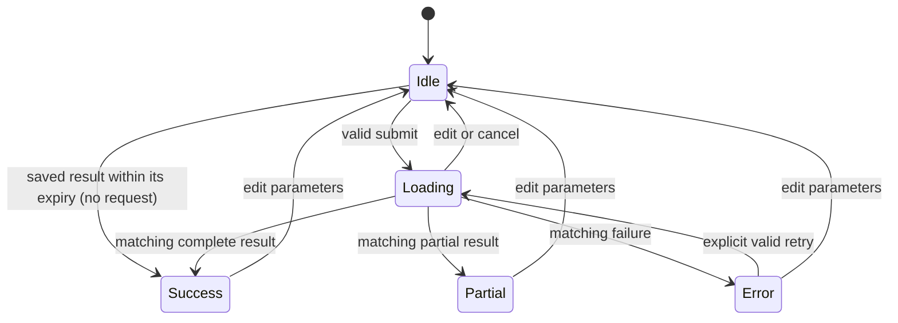

# Frontend state

Reviewed 2026-10-14. FE-001 to FE-008 are DONE: the dashboard searches places, takes a bounding box or a map pick, validates input, wakes the API on page load, runs analyses against the real API with stale-response protection, reuses saved results inside their backend expiry, shows honest loading stages, and renders metrics, a heatwave calendar linked to three line charts, a year detail panel, provenance, quality, insights, events (with CSV export) and errors.

State ownership: the page owns draft inputs; `useServerStatus` owns the one wake-up check; `useAnalysis` owns immutable submitted parameters, the active request token/controller, phase, result, safe error and the per-tab saved-result cache; `ResultsView` owns the hovered and selected year for one result; presentation receives props. No global store.

No-events is Success with zero count. Insufficient data is a typed Error. Obsolete success/errors have no transition. Pending cleanup on unmount prevents setting stale state. Source cache metadata is server-derived; the browser does not manufacture freshness. A saved result is reused only while the backend's `cache.expires_at` is in the future, is relabelled with the current label and is announced as saved; failures are never saved. Fresh cache hits are not stale results. The contract prohibits stale-result fallback, so the UI brief creates no stale-success transition. All visual states use [grayscale design](design.md); no actual reference image/local weather asset exists.

Server status is separate from the analysis phase: checking → waking (no answer after 1.5 s) → ready, or unreachable. It only changes messages; an analysis can still run when the wake-up check fails.

Map picks are draft edits like typing: they fill the coordinates and return a shown result to Idle. The page tracks whether the user typed the label; a map pick keeps a typed label and otherwise writes a coordinate label. Places that arrive from typing, search or a city button centre the picker map; picks made on the map leave the view alone.

Year views live inside Success and Partial. Hovering a calendar row or a chart sets a transient hovered year shared by every chart; clicking a row or chart, or choosing in "Inspect a year", sets the selected year, which opens the year panel and filters the events table. Escape, "Show all years" or clicking the selected row clears it. Editing any input returns to Idle, so a selection never outlives its result.

All 13 frontend design concepts (9–21) are expanded in [system design](system.frontend.md); the [85-concept coverage](../../docs/system-design-coverage.md) maps tasks/tests. Client source types follow contract 0.2 (NASA POWER or Open-Meteo ERA5, nullable resolved point).

Next: the README of decisions and trade-offs, then deployment of the map branch after approval. Record checks in [testing](testing.md), task evidence in [tasks](tasks.md), and durable decisions in [memory](memory.md).
