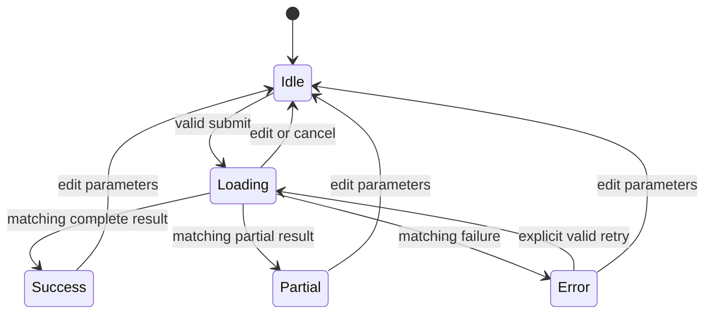

# Frontend state

Reviewed 2026-10-14. FE-001, FE-002 and FE-003 are DONE: the dashboard searches places, validates input, runs analyses against the real API with stale-response protection, and renders metrics, three charts, provenance, quality, insights and errors. FE-005 is IN_PROGRESS (screenshot review and interaction profiling pending); FE-004 (boxes) is TODO.

Planned state ownership: page owns draft inputs; request hook owns immutable submitted parameters, active request token/controller, phase, result and safe error; presentation receives props. No global store.

No-events is Success with zero count. Insufficient data is a typed Error. Obsolete success/errors have no transition. Pending cleanup on unmount prevents setting stale state. Source cache metadata is server-derived; the browser does not manufacture freshness. Fresh cache hits are not stale results. The contract prohibits stale-result fallback, so the UI brief creates no stale-success transition. All visual states use [grayscale design](design.md); no actual reference image/local weather asset exists.

All 13 frontend design concepts (9–21) are expanded in [system design](system.frontend.md); the [85-concept coverage](../../docs/system-design-coverage.md) maps tasks/tests. Client source types follow contract 0.2 (NASA POWER or Open-Meteo ERA5, nullable resolved point).

The subsequent DOC-007 workflow update aligns planning, package research, UI/review/simplification and final evidence gates with [the shared workflow](../../docs/ai-development-workflow.md). No tool installed or frontend implementation performed. Shared DOC-008 is conditional, not a dependency of manual frontend work.

Next: FE-001 following the [plan](implementation-plan.md). Record checks in [testing](testing.md), task evidence in [tasks](tasks.md), and durable decisions in [memory](memory.md).

In progress (2026-10-14, branch `feature/fast-start-and-heatwave-calendar`): FE-006 fast start (server wake-up status, in-browser result reuse within backend expiry, honest loading stages) and then FE-007 heatwave calendar with linked year views. See the [plan](implementation-plan.md).
