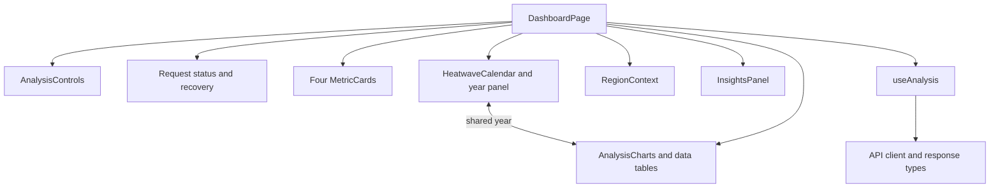
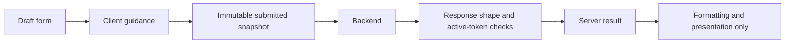
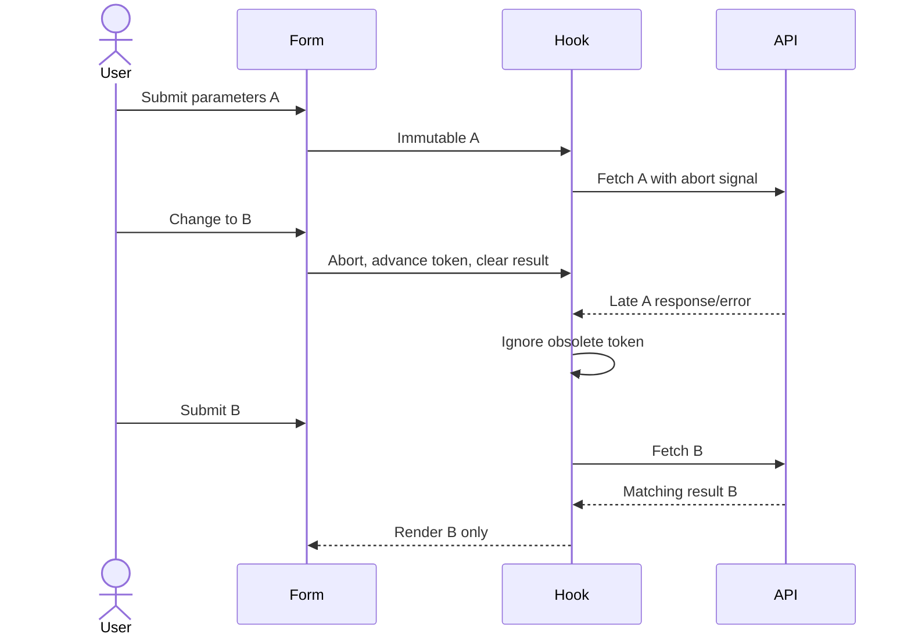
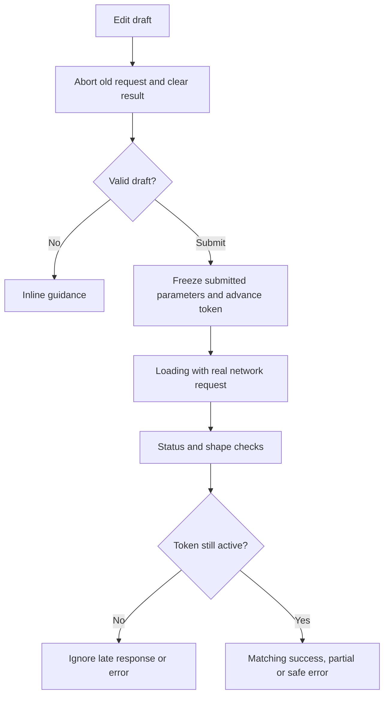
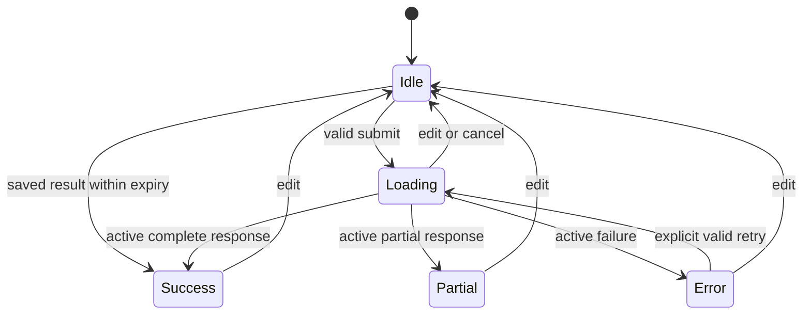

# Frontend system design

Separation of concerns keeps a chart change from breaking network behavior. This application needs one React page and local state, not micro-frontends, a global store or a router. TypeScript types must track the [backend contract](../../INTEGRATION_CONTRACT.md); type assertions alone do not validate network data.

## Planned components and modules

| Component/module | Input/output and responsibility | Verification |
|---|---|---|
| `DashboardPage` | Composes form and result states; owns draft parameters | State/interaction tests |
| `AnalysisControls` | Draft values, validation, onChange/onSubmit, pending | Labels, keyboard, invalid/long input |
| `useAnalysis` | Request state, AbortController, token, submit/reset, per-tab saved results (`resultCache.ts`) | Stale response/error, timeout, duplicate behavior, cache hit/expiry, no error caching |
| `useServerStatus` | One health check per page load; checking/waking/ready/unreachable | Fake-timer state tests, abort on unmount |
| `LoadingView` | Real stages, elapsed seconds, static placeholders, slow-wait note | No digits in placeholders, timers, axe |
| `api/client.ts` and `api/types.ts` | Typed HTTP boundary, safe error decoding, minimal shape checks | JSON/non-JSON/invalid/null responses |
| `MetricCard` | Label, formatted value, unit, explanation | Null/large numbers/long labels |
| `AnalysisCharts` | Backend annual rows; focused chart configs and table alternatives | Null gaps, resize, legend/keyboard |
| `HeatwaveCalendar` and `calendar.ts` | Backend events by year and day of year; display-only excess groups | Leap years, cross-year splits, markers, empty state |
| Year panel (`ResultsView`) | Hovered/selected year shared by calendar and charts; selected year's values and events | Linked hover, click/select/Escape, filtered events table |
| `RegionContext` | Region/source sample points and limitation, with the result map | No fabricated heatmap; narrow layout |
| `map/geometry.ts`, `map/maps.tsx`, `map/lazy.ts` | Shapes from a result or draft, map picks to coordinates; Leaflet result map and picker in a lazily loaded chunk, injected into the page like the health check | Honest cells, picks, centring, label rule, stable shapes, axe |
| `InsightsPanel` | Backend evidence/warnings/methodology | Wrapping, semantic hierarchy |

Keep the three plots together initially; split a chart only when its own behavior warrants it. Extract state/empty/error presentation only if reuse helps. Avoid a generic dashboard framework.

## State, safety and performance

Draft form is local UI state; a submitted snapshot identifies server state. Do not recompute scientific results from chart data. [State transitions](state.md) define behavior. A single pending lifecycle can serve charts/metrics/insights so they never display different analyses.

Use fetch with an explicit deadline and abort cleanup on edits/unmount. Inspect status/content type, translate errors safely and validate required response shape/invariants before presentation. Full schema-generation/runtime-validation tooling is a future choice, not a reason to add a dependency immediately. Preserve null rather than coercing to zero.

React escapes text by default; avoid raw HTML. The API base URL is public configuration, and credentials must never enter frontend settings. Source links come from a trusted allowlist. Retry is explicit because analysis can cause expensive upstream work.

CSS owns responsive composition; charts measure their containers. Avoid fixed-width children and use min-width:0. Include a data table/detail path because pointer hover alone is inaccessible. Respect reduced motion and meaningful focus order. Reuse one returned annual dataset for all plots without recalculation or unnecessary transformation caches. Series arrays and calendar segments are memoised per result so hover, which updates state only when the year changes, does not rebuild them; with at most 50 annual rows, complex state infrastructure is unwarranted.

Later: optional map lazily loaded after core, exported data if requested, schema generation if duplication becomes costly. Required now: clear state ownership, safe HTTP boundary, chart alternatives and viewport evidence.

## Concept implementation guide (9–21)

All frontend modules remain planned. This document owns component architecture, composition and API-consumption responsibilities. [State](state.md) owns transition semantics; [screens](screens.md) owns journeys/presentation; [design](design.md) owns tokens; [responsive evidence](responsiveness.md) owns viewport acceptance. The [coverage matrix](../../docs/system-design-coverage.md) links the concepts to the complete task graph.

| ID / concept | Meaning, project need and owner | Approach and acceptance | Tests / tasks | Avoid / defer |
|---|---|---|---|---|
| 9 Component-driven architecture | Components are coherent interface units; isolate controls, metrics and plots so one change does not break all states | Explicit props; one result passed to every result section; modules follow the component tree | UI-DESIGN / UI-METRICS; FE-001, FE-003 | Do not create a component for every wrapper |
| 10 Component composition | Page assembles domain components in meaningful reading order | Header/form, state, results; presentation never fetches independently; mobile DOM order remains logical | Render each state; FE-001, FE-003 | No general dashboard framework or duplicated mobile tree |
| 11 UI versus business logic | Browser explains authoritative results; backend owns science | Format numbers/units only; no percentile, trend, rolling-window or event recomputation | Fixture values/zero/null match wire data; FE-003 | No client-generated climate findings |
| 12 State management | One page needs explicit ownership, not a global store | Local draft and one useAnalysis lifecycle; cleanup on edit/unmount; helpers only where reused; ResultsView owns hovered/selected year | UI-LIFECYCLE; FE-002, FE-006, FE-007 | Defer state library until multiple independent consumers justify it |
| 13 Server versus UI state | Draft changes are not a new server result | Submitted snapshot and result are immutable; cache/source fields only come from backend | Edit after success/pending; FE-002 | Never attach current form labels to old results |
| 14 API client | A single HTTP boundary makes failures and validation consistent | Shared base URL, timeout, abort, content-type/status guards, required shape checks and typed errors; reject incompatible contract | CONTRACT-INPUT/OUTPUT, non-JSON/invalid payload; FE-002 | No raw error traces, credentials or unchecked type assertions |
| 15 UI state machine | Explicit transitions prevent contradictory spinners/results | Idle/loading/success/partial/error; active-token guards cover both resolved and rejected promises; duplicate Analyze disabled; saved results go straight to success | Late success/error, duplicate, unmount, retry, cache hit/expiry; FE-002, FE-006 | No fake percentages or background automatic retry loop |
| 16 Responsive design | Content must remain usable from 320px upward | Fluid Grid/Flex, min-width:0, responsive chart containers, wrapped filters; nine test sizes, max-width on wide screens | UI-RESPONSIVE; FE-001, FE-005 | Breakpoints follow actual fit, not device detection |
| 17 Accessibility | Users must operate and interpret results without pointer/color/motion | Labels, native controls, visible focus, announcements, textual chart details, contrast and reduced motion; preserve focus on rerender | UI-A11Y manual plus automated; FE-002, FE-003, FE-005 | Hover-only tooltips and color-only legends are insufficient |
| 18 Visualization architecture | Three views share one consistent backend dataset | Nulls produce gaps; grayscale brightness plus line patterns/markers, years/units/readable ticks; keyboard or table detail path; geographic display uses actual sample points; a heatwave calendar of backend events shares the year cursor with every chart | UI-CHARTS/GEOGRAPHY; FE-003, FE-007 | Recharts remains provisional; no invented heatmap or second chart library |
| 19 Performance | Small annual datasets should render predictably without heavy infrastructure | Measure compressed production bundle and interaction/render cost; wake the API on load; reuse saved results within expiry; lazy-load optional geography only if adopted | Bundle report, browser profile; FE-005, FE-006 | No speculative memoization or global server-state cache |
| 20 Error recovery | A failed upstream request must leave an understandable next action | Preserve editable input, announce safe error/request ID, explicit retry; partial data has warnings and visible gaps | UI-LIFECYCLE, long/network/storage errors; FE-002, FE-003 | Do not hide partial data warnings or stale results behind a spinner |
| 21 Testing | Behavior tests prevent regressions beyond a successful build | Unit interaction tests, paired contract fixtures, then real backend/browser flow; visibly label development fixtures | Full testing matrix; FE-001, FE-002, FE-003, FE-005 | No production fixture fallback; no viewport pass without actual evidence |

## Request lifecycle and state transitions

The diagram below visualizes the canonical rules in [state](state.md). No-events belongs to Success; insufficient data belongs to Error. A partial result is never silently upgraded to complete.

## API compatibility and unresolved source decision

Consume the canonical [integration contract](../../INTEGRATION_CONTRACT.md), not the internal provider adapter shape. DOC-004 proposes source metadata capable of representing NASA POWER and ERA5 without false grid/model labels. Until approved, there is no NASA-compatible analysis wire response. FE-002 can develop local state/interaction fixtures against the agreed shape, but final contract compatibility depends on that decision. FE-003 cannot claim live integration until BE-007 and the contract fixtures pass.

Required now: one page, consistent tokens, lifecycle correctness and honest data rendering. Deferred: routing, authentication, global stores, maps/exports and virtualization without a product need. The full layout behavior and every viewport remain unverified until FE-005 records browser evidence.
